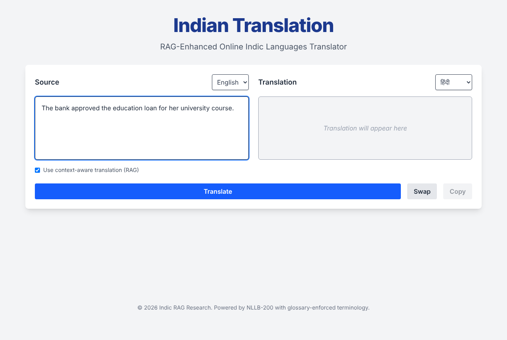
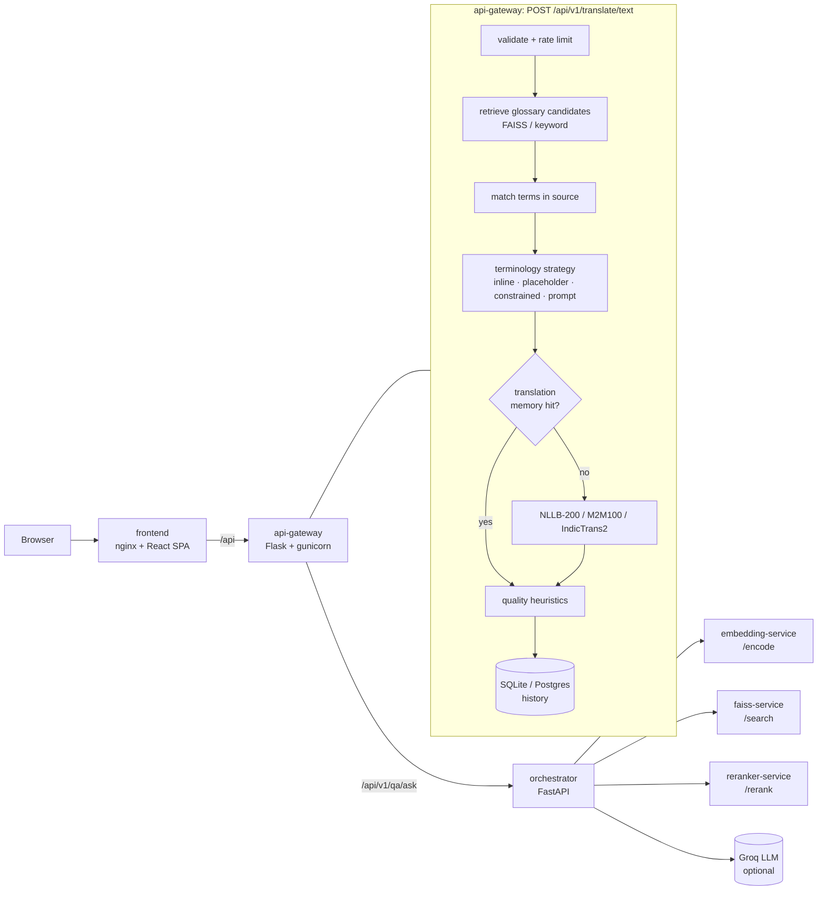

# Indic Translator with Terminology Enforcement

English ↔ 7 Indic languages (Hindi, Marathi, Bengali, Gujarati, Tamil,
Telugu, Kannada) on CPU, with NLLB-200-distilled-600M, M2M100-418M and
IndicTrans2 behind one API. Domain glossaries are enforced at translation
time. The evaluation harness measures how much that actually helps.

[](https://github.com/PrathameshTawar/translations-/actions/workflows/ci.yml)



## What it does

1. **Translate** with the best available model for the language pair, with a
   translation memory (exact + semantic cache) in front of it.
2. **Find glossary terms** in the source: dense retrieval
   (multilingual MiniLM + FAISS, optional cross-encoder rerank) proposes
   candidates, exact glossary matches are always added, and only terms that
   actually occur in the sentence are kept.
3. **Enforce them** with one of five strategies, chosen per request or with
   `TERMINOLOGY_STRATEGY`:

   | Strategy | How | Trade-off |
   | --- | --- | --- |
   | `none` | plain translation | baseline |
   | `prompt` | glossary lines prepended to the input (the original approach) | NLLB wasn't trained on this format and echoes it; kept only as an ablation baseline |
   | `inline` *(default)* | the English term is replaced by its glossary translation before translation ([Song et al., 2019](https://aclanthology.org/N19-1044/)) | no extra latency, and the model can still inflect around the term |
   | `placeholder` | mask the term, translate, restore | falls back to plain translation if the model drops the placeholder |
   | `constrained` | lexically constrained beam search (`force_words_ids`) | the term is guaranteed to appear, but decoding is slower and it can't inflect; NLLB only |

4. **Score** the output with a reference-free heuristic (length ratio,
   glossary-term coverage, script consistency) and return per-stage timings.

The default (`inline`) was chosen on design grounds. It becomes a result only
once the ablation below is run on FLORES-200.

## Results

| Report | Status |
| --- | --- |
| [`reports/2026-10-15_offline`](reports/2026-10-15_offline/benchmark.md): test suites, retrieval, language ID (no models needed) | **2 PASS / 2 FAIL / 5 not measured** |
| FLORES-200 devtest quality table and terminology ablation | **Not run yet**: they need the models and the gated FLORES-200 data ([how to run](reports/README.md#not-yet-run)) |
| 2026-08-12 curated-set run (removed; in git history) | Superseded: 42 curated sentences with machine-generated references ([why not to quote it](reports/README.md#why-the-2026-08-12-numbers-should-not-be-quoted)) |

The current scorecard's two FAILs are expected. The shipped glossaries have
**15 terms** per language, far below the 1,000-entry index size the
retrieval target requires. The offline keyword backend also finds 0% of the
paraphrased mentions (sentence queries: 97.8% Recall@5). A larger glossary is
the most valuable next step for this project.

Every target and the reason for it is fixed in code before a run
([`DEFAULT_TARGETS`](backend/app/evaluation/report.py)). Test-suite pass rates
are reported as counts and never scored as achievements. Stub-backed numbers
show as NOT MEASURED.

## Architecture



`docker-compose.yml` runs six services. The translate path runs inside the
API gateway. The orchestrator and its three model services serve the
optional grounded-QA endpoint, which needs `GROQ_API_KEY`.

## Quick start

### Docker

```bash
cp .env.example .env        # set SECRET_KEY and JWT_SECRET_KEY (≥ 32 chars)
docker compose up --build -d
open http://localhost:3000  # API: http://localhost:8080/api/health
```

The first build downloads torch and transformers (~3–5 GB). The first
translation cold-loads NLLB, which takes 15–30 s.

### Local development

```bash
# backend (Python 3.11+)
cd backend
python -m venv .venv && source .venv/bin/activate   # Windows: .venv\Scripts\activate
pip install -r requirements.txt
python wsgi.py                                      # http://localhost:5000

# frontend (Node 20+), in another shell
cd frontend
npm ci
npm run dev                                         # http://localhost:5173, proxies /api to :5000
```

### Tests

```bash
cd backend
pip install -r requirements-ci.txt   # no torch, no model downloads
python -m pytest tests -q
```

CI runs these tests on Python 3.11 and 3.12, along with the frontend lint
and build and a `docker compose config` check.

## Evaluation

All commands run from `backend/`.

```bash
# Model-free suites: functional, security, e2e, unicode, retrieval, language ID
python scripts/run_benchmark.py

# Retrieval at a realistic index size (pad with any term list, one per line)
python -m app.evaluation.retrieval --pad-index english_terms.txt

# Main quality table: FLORES-200 devtest (1,012 sentences), real models
python scripts/run_benchmark.py --live --flores 1012 --flores-dir /path/to/flores200_dataset

# Terminology on/off ablation on the term-bearing FLORES subset
python scripts/run_ablation.py --lang hindi,tamil --dataset flores \
    --flores-dir /path/to/flores200_dataset --glossary my_glossary.json
```

The ablation keeps the FLORES sentences where a glossary term occurs in the
source and its glossary translation occurs in the reference (the protocol of
[Dinu et al., 2019](https://aclanthology.org/P19-1294/)). On that subset it
reports, for each strategy:

- term accuracy
- chrF++, with the delta vs `none` and a paired-bootstrap 95% CI
- BLEU
- fallback rate
- latency

Runs with fewer than 200 sentences are flagged underpowered.

## API

| Endpoint | Auth | Notes |
| --- | --- | --- |
| `POST /api/v1/translate/text` | optional JWT | `{text, source_lang, target_lang, include_context?, terminology_strategy?, model?, num_beams?, top_k?, use_reranker?}`; 30/min per IP |
| `POST /api/v1/translate/detect` | none | script + lexical language ID |
| `GET /api/v1/translate/languages`, `/models` | none | |
| `POST /api/v1/auth/register`, `/login` | none | 10/min per IP |
| `GET/DELETE /api/v1/history/...` | JWT | own translations only |
| `POST /api/v1/qa/ask` | none | grounded QA; needs `GROQ_API_KEY` |
| `POST /api/v1/evaluate/run` | `X-Admin-Token` | full benchmark; 2/hour, one at a time |
| `GET /api/v1/tm/entries`, `POST /api/v1/tm/clear`, `/save` | `X-Admin-Token` | |

Admin endpoints are disabled until `ADMIN_TOKEN` is set.

## Configuration

| Variable | Default | Purpose |
| --- | --- | --- |
| `SECRET_KEY`, `JWT_SECRET_KEY` | dev values | required in production, at least 32 characters; placeholders are rejected at startup |
| `DATABASE_URL` | `sqlite:///translator.db` | required in production |
| `ADMIN_TOKEN` | empty (admin endpoints off) | shared secret for `X-Admin-Token` |
| `TERMINOLOGY_STRATEGY` | `inline` | `none`, `prompt`, `inline`, `placeholder`, `constrained` |
| `NLLB_NUM_BEAMS` | `2` | beam size (latency vs quality) |
| `RATELIMIT_*` | see `app/config.py` | per-route limits; `RATELIMIT_STORAGE_URI=redis://…` shares them across workers |
| `BEHIND_PROXY` | `false` | trust one `X-Forwarded-For` hop (set in compose) |
| `GROQ_API_KEY`, `GROQ_MODEL` | empty, `llama-3.1-8b-instant` | grounded QA |
| `RAG_INDEX_DIR` | `backend/data/indexes` | FAISS indexes, built on demand from the glossaries |
| `FLORES_DIR` | empty | local FLORES-200 plain-text release |

## Repository layout

```
backend/
  app/            Flask app: routes, services (models, RAG, terminology, TM), evaluation
  data/           terminology glossaries, evaluation query set
  scripts/        run_benchmark.py, run_ablation.py, build_faiss_index.py, ...
  tests/          pytest suite (pure logic, runs in CI)
frontend/         React + Vite + Tailwind
deploy/           Dockerfiles, nginx, FastAPI microservices for the QA pipeline
reports/          committed benchmark runs (see reports/README.md)
docs/             screenshots
```

## Known limitations

- **Glossaries have 15 terms per language.** Nothing measured on them is
  strong evidence, and the scorecard says so. A real termbase is needed, for
  example a domain glossary you have the rights to use.
- **Constrained decoding** depends on the installed transformers version
  still shipping constrained beam search. When it doesn't, the API reports a
  fallback instead of failing.
- **The quality-estimation heuristic** is a sanity filter, not a calibrated
  QE model. COMETkiwi support exists (`--qe-model cometkiwi`) but is optional.
- **Rate limits** are per worker with the default in-memory storage.
